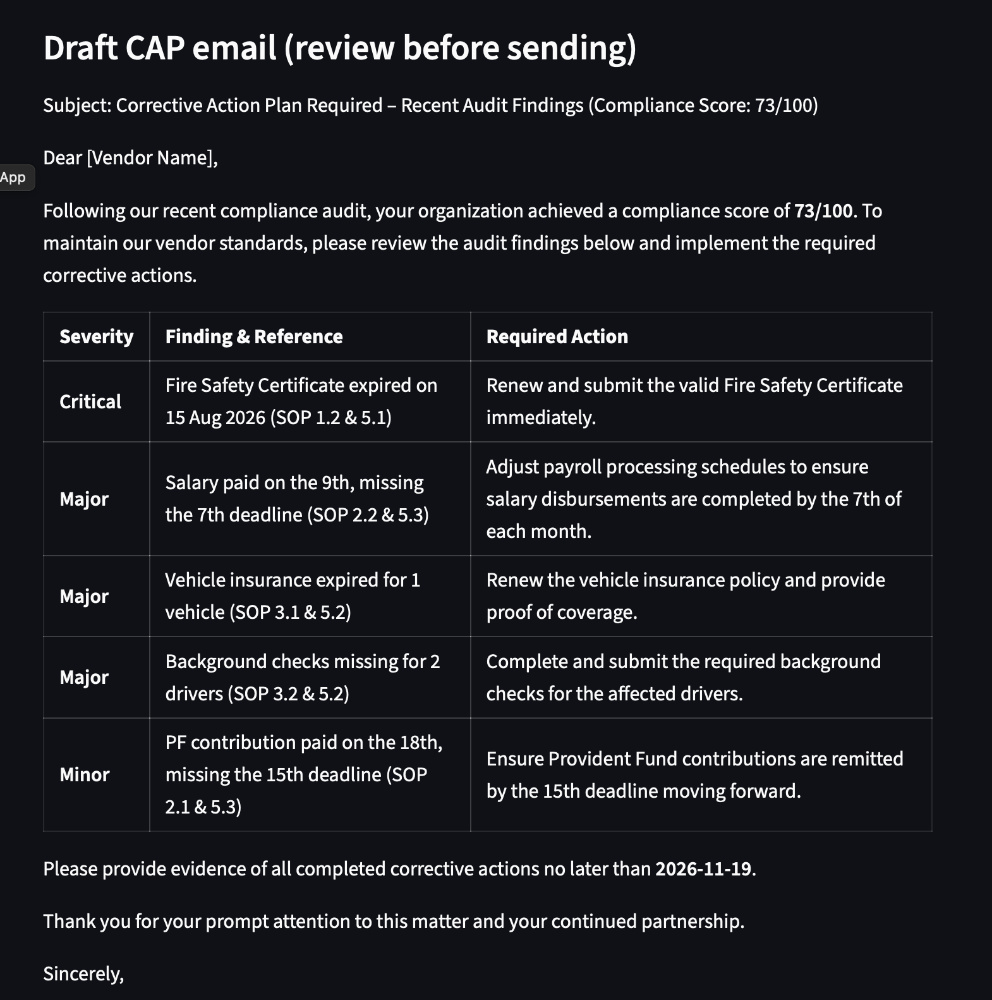

# Vendor Compliance Audit Assistant

A generative AI app that audits a vendor submission against a compliance SOP, scores it, and drafts a Corrective Action Plan (CAP) email. Built as a learning project using sample data only.

**Live demo:** https://vendor-audit-assistant-mauujpsgaac7gqd5hvn4gc.streamlit.app




## What it does
1. Reads an SOP (the rules) and a vendor submission.
2. An LLM finds the real breaches, citing the SOP rule for each.
3. Python calculates the compliance score from the SOP's point system.
4. The LLM drafts a CAP email with a deadline calculated in code, for a human to review before sending.

## How it works
- **Chunking:** documents are split at section boundaries, so each chunk is a complete rule.
- **Embeddings and retrieval:** chunks are embedded and stored in Chroma, with metadata filtering so rule questions search only the SOP.
- **Grounded answers (RAG):** the model answers only from retrieved text, cites the rule, and says it doesn't know when the answer isn't there.
- **Audit agent:** the LLM audits and drafts, while code handles the score and dates.
- **Interface:** Streamlit, deployed on Streamlit Community Cloud.

## Design decisions
- Scoring is done in code, because LLMs are unreliable at arithmetic.
- Temperature is 0, and the severity guide lives in the SOP, so repeated runs give the same score.
- Fixed-size chunking cut facts in half and mixed topics, so I switched to structure-aware chunking.
- A metadata filter fixed a case where vendor data outranked the SOP rule for a rules question.
- API calls retry automatically when the model is overloaded.

## Project files
- `load_docs.py`: loads documents and splits them by section
- `build_index.py`: embeds chunks and stores them in Chroma
- `ask.py` and `answer.py`: retrieval, and grounded Q&A with citations
- `agent.py`: the audit agent (findings, score, CAP email)
- `score.py`: scoring from the SOP's point system
- `app.py`: Streamlit interface
- `data/`: sample SOP and two sample vendor submissions (all fictional)

## Tech
Python, Gemini API, Chroma, Streamlit

## Limitations and next steps
- Uses fictional sample data and a small SOP.
- A human should review the CAP email before it is sent.
- Next: PDF upload, a test set to measure accuracy, and retrieving only the relevant SOP sections for large SOPs.

## Run locally
```
python3.13 -m venv venv
source venv/bin/activate
pip install -r requirements.txt
streamlit run app.py
```
Create a `.env` file with `GEMINI_API_KEY=your_key`. To run the retrieval scripts (`build_index.py`, `ask.py`, `answer.py`), also run `pip install chromadb`.

## Author
Udayakumar Reshmi | https://www.linkedin.com/in/udayakumar-reshmi/